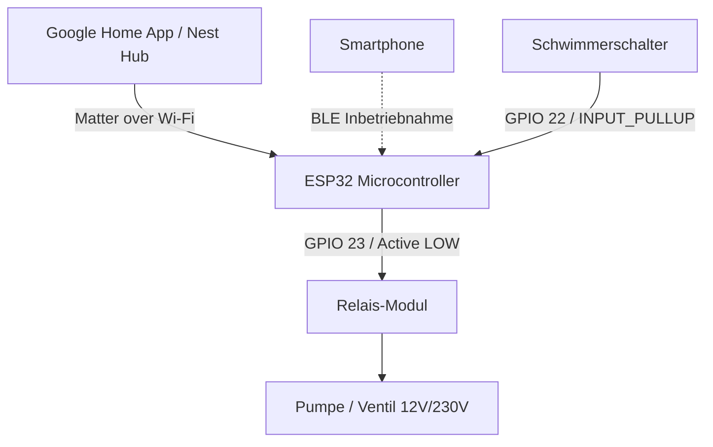

# 🌱 ESP32 Smart Watering (Matter-over-Wi-Fi)

Ein smartes Bewässerungssystem auf Basis des **ESP32** mit nativer **Matter-over-Wi-Fi**-Unterstützung zur direkten Einbindung in **Google Home**, **Apple Home** oder **Home Assistant** – ganz ohne proprietäre Bridge.

Das System steuert eine Wasserpumpe bzw. ein Magnetventil über ein Relais und verfügt über einen integrierten **Trockenlaufschutz** via Schwimmerschalter im Wassertank oder Regenfass.

---

## 📋 Inhaltsverzeichnis

- [Features](#-features)
- [Systemarchitektur](#-systemarchitektur)
- [Hardware-Anforderungen](#-hardware-anforderungen)
- [Pinbelegung & Verdrahtung](#-pinbelegung--verdrahtung)
- [Vollständiger Schaltplan (SKETCH.md)](SKETCH.md)
- [Software-Voraussetzungen](#-software-voraussetzungen)
- [Installation & Flashen](#-installation--flashen)
- [Inbetriebnahme mit Google Home](#-inbetriebnahme-mit-google-home)
- [Sicherheitslogik (Trockenlaufschutz)](#-sicherheitslogik-trockenlaufschutz)
- [Projektstruktur](#-projektstruktur)
- [Erweiterungsmöglichkeiten](#-erweiterungsmöglichkeiten)

---

## ✨ Features

- **Natives Matter-over-Wi-Fi**: Wird direkt als smarter Aktor (*On/Off Outlet / Steckdose*) von Matter-Controllern erkannt.
- **Google Home Integration**: Steuerung per App, Sprachbefehl (*„Hey Google, schalte die Gartenbewässerung ein“*) und Automatisierungen / Zeitpläne.
- **Hardware-Trockenlaufschutz**:
  - Verhindert das Einschalten bei leerem Wassertank.
  - Sofortige Not-Abschaltung im laufenden Betrieb, falls der Wasserstand unter die Minimalmarke sinkt.
- **BLE Commissioning**: Einfaches Koppeln über Bluetooth Low Energy direkt mit dem Smartphone.
- **Keine Cloud-/Bridge-Pflicht**: Lokale Kommunikation über den Matter-Standard im Heimnetzwerk.

---

## 🏛 Systemarchitektur



---

## 🛠 Hardware-Anforderungen & Einkaufsliste

Die folgenden Komponenten werden für den Aufbau benötigt. Über die Links gelangst du direkt zu passenden Angeboten auf Amazon:

| Komponente | Spezifikation / Empfehlung | Bezugsquelle (Amazon) |
| :--- | :--- | :--- |
| **ESP32 Dev Module** | ESP32-WROOM-32 / NodeMCU (mind. **4 MB Flash**, Wi-Fi + BLE) | [🛒 Auf Amazon suchen](https://www.amazon.de/s?k=ESP32+NodeMCU+Development+Board) |
| **1-Kanal Relais-Modul** | 5V Steuerkreis mit Optokoppler, Active-LOW, Schließer (`NO`) | [🛒 Auf Amazon suchen](https://www.amazon.de/s?k=Relais+Modul+5V+1+Kanal+Optokoppler) |
| **Schwimmerschalter** | Pegelsensor / Reed-Kontakt für Wassertank (`INPUT_PULLUP` gegen GND) | [🛒 Auf Amazon suchen](https://www.amazon.de/s?k=Schwimmerschalter+Wasserstandssensor) |
| **12V DC Tauchpumpe** | 12V Kleinspannungs-Tauchpumpe für Garten/Wassertank | [🛒 Auf Amazon suchen](https://www.amazon.de/s?k=12V+Tauchpumpe+Garten+Wasser) |
| **12V DC Netzteil** | 12V DC Steckernetzteil, mind. 2A bis 3A | [🛒 Auf Amazon suchen](https://www.amazon.de/s?k=12V+2A+Netzteil+DC) |
| **Step-Down Wandler** | LM2596 / Buck-Converter (wandelt 12V in stabile 5V für ESP32/Relais) | [🛒 Auf Amazon suchen](https://www.amazon.de/s?k=LM2596+Step-Down+Wandler) |
| **Freilaufdiode** | 1N4007 Gleichrichterdiode (Schutz vor induktiver Rückspannung) | [🛒 Auf Amazon suchen](https://www.amazon.de/s?k=1N4007+Gleichrichterdiode) |
| **Jumper-Kabel** | Dupont-Kabel (Female-to-Female & Male-to-Female) | [🛒 Auf Amazon suchen](https://www.amazon.de/s?k=Jumper+Kabel+Dupont) |
| **Gehäuse (Optional)** | Wasserdichte IP65 Abzweigdose für Außeneinsatz | [🛒 Auf Amazon suchen](https://www.amazon.de/s?k=IP65+Elektronik+Geh%C3%A4use+wasserdicht) |
| **Matter Controller** | Google Nest Hub, Nest Audio oder Nest Mini im Heimnetzwerk | [🛒 Auf Amazon suchen](https://www.amazon.de/s?k=Google+Nest+Hub) |

---

## 🔌 Pinbelegung & Verdrahtung

| Komponente | ESP32 GPIO | Modus | Bemerkung |
| :--- | :--- | :--- | :--- |
| **Relais (Pumpe)** | `GPIO 23` | `OUTPUT` | Active-LOW: `LOW` = Relais AN, `HIGH` = Relais AUS |
| **Schwimmerschalter** | `GPIO 22` | `INPUT_PULLUP` | Gegen `GND` geschaltet (`LOW` = Wasser vorhanden) |

### Schematischer Anschluss

```
ESP32                    Relais-Modul
  GPIO 23  ------------> IN
  GND      ------------> GND
  5V/VIN   ------------> VCC

ESP32                    Schwimmerschalter (Tank)
  GPIO 22  ------------> Kontakt 1
  GND      ------------> Kontakt 2
```

> [!TIP]
> Der ausführliche Gesamtschaltplan inklusive 12V-Netzteil, Step-Down-Wandler, Relais-Lastseite, Freilaufdiode und Pumpenbeschaltung ist in [SKETCH.md](file:///Users/martinkade/Projekte/SmartHome/Watering/SKETCH.md) dokumentiert.

---

## 💻 Software-Voraussetzungen

- **Arduino IDE** (Version 2.x empfohlen)
- **ESP32 Arduino Core** Version **3.0.0 oder neuer** (enthält die offizielle Matter-Bibliothek von Espressif):
  - In der Arduino IDE unter *Werkzeuge $\rightarrow$ Board $\rightarrow$ Boardverwalter* nach `esp32` (by Espressif) suchen und aktualisieren.

### Board-Einstellungen in der Arduino IDE

Unter dem Menü **Werkzeuge (Tools)** folgende Optionen wählen:
- **Board:** `ESP32 Dev Module` (oder passendes Modell)
- **Flash Size:** `4MB (32Mb)`
- **Partition Scheme:** `Minimal SPIFFS (Large APPS with OTA)` oder ein Matter-kompatibles Partitions-Schema
- **Upload Speed:** `921600` (oder `115200`)

---

## 🚀 Installation & Flashen

1. Öffne die Sketch-Datei [sketch/sketch.ino](file:///Users/martinkade/Projekte/SmartHome/Watering/sketch/sketch.ino) in der Arduino IDE.
2. Verbinde das ESP32-Board über USB mit dem Computer.
3. Wähle den korrekten COM-Port unter *Werkzeuge $\rightarrow$ Port*.
4. Klicke auf **Hochladen** (Upload).
5. Öffne nach dem Upload den **Seriellen Monitor** mit einer Baudrate von `115200`.

---

## 📱 Inbetriebnahme mit Google Home

1. **Seriellen Monitor prüfen**:
   Beim ersten Booten meldet der ESP32:
   ```text
   Warte auf Matter-Inbetriebnahme...
   Gerät ist noch nicht gekoppelt.
   Öffne Google Home -> 'Gerät einrichten' -> 'Matter-fähiges Gerät'
   Manueller Setup-Code: XXXXXXXXXXX
   ```
   Notiere dir den 11-stelligen **Setup-Code**.

2. **Google Home App öffnen**:
   - Tippe auf **Geräte** $\rightarrow$ **+ Hinzufügen** $\rightarrow$ **Matter-fähiges Gerät**.
   - Wähle **„Ohne QR-Code fortfahren“** bzw. **„Code eingeben“**.
   - Gib den angezeigten 11-stelligen Kopplungscode ein.

3. **Verbindung herstellen**:
   - Das Smartphone verbindet sich via BLE mit dem ESP32 und überträgt die WLAN-Zugangsdaten.
   - Weise das Gerät einem Raum zu (z. B. *„Garten“*) und benenne es (z. B. *„Gartenbewässerung“*).

4. **Sprachsteuerung**:
   - *„Hey Google, schalte die Gartenbewässerung für 2 Minuten ein.“*
   - *„Hey Google, ist die Gartenbewässerung an?“*

---

## 🛡 Sicherheitslogik (Trockenlaufschutz)

Das System schützt die Pumpe in zwei Stufen vor Trockenlaufschäden:

1. **Präventive Einschaltblockade** ([sketch.ino:L40-L68](file:///Users/martinkade/Projekte/SmartHome/Watering/sketch/sketch.ino#L40-L68)):
   - Erhält der ESP32 einen Einschaltbefehl von Google Home, prüft `onPumpStateChange()`, ob der Schwimmerschalter geschlossen ist (`LOW`).
   - Ist der Tank leer (`HIGH`), wird das Relais **nicht** aktiviert und der Status in Google Home sofort wieder auf `AUS` gesetzt.

2. **Echtzeit-Notabschaltung** ([sketch.ino:L112-L121](file:///Users/martinkade/Projekte/SmartHome/Watering/sketch/sketch.ino#L112-L121)):
   - Im `loop()` wird kontinuierlich überwacht, ob während des Betriebs der Wasserpegel abfällt.
   - Sinkt der Pegel unter das Limit, schaltet der ESP32 das Relais unmittelbar ab und setzt den Matter-Status auf `false`.

---

## 📁 Projektstruktur

```
Watering/
├── .agents/
│   └── skills/
│       └── esp32-matter-firmware/ # KI-Agent Skill (Workflows & Checks)
├── .gitignore          # Git-Ausschlussregeln (Build-Dateien, OS-Dateien)
├── AGENTS.md           # Leitfaden & Sicherheitsregeln für KI-Agenten
├── PROJECT.md          # Ursprüngliche Notizen & Matter-Konzept
├── README.md           # Projektdokumentation
├── SKETCH.md           # Detaillierter Hardware-Schaltplan & Verdrahtung
└── sketch/
    └── sketch.ino      # Arduino-Quellcode für ESP32 Matter-Client
```

---

## 🔮 Erweiterungsmöglichkeiten

- **Bodenfeuchtesensor (kapazitiv)**: Einbinden eines kapazitiven Feuchtesensors über einen analogen Pin (z. B. `GPIO 34`), um Bewässerung nur bei unterschrittener Bodenfeuchte zuzulassen.
- **Home Assistant & ESPHome**: Alternativer Betrieb über Home Assistant mit ESPHome und Übergabe der Entitäten an Google Home via Home Assistant Matter-Bridge.
- **Sicherheits-Timer (Timeout)**: Maximalbegrenzung der Pumpenlaufzeit (z. B. max. 5 Minuten am Stück) als Software-Watchdog gegen Überschwemmungen.
