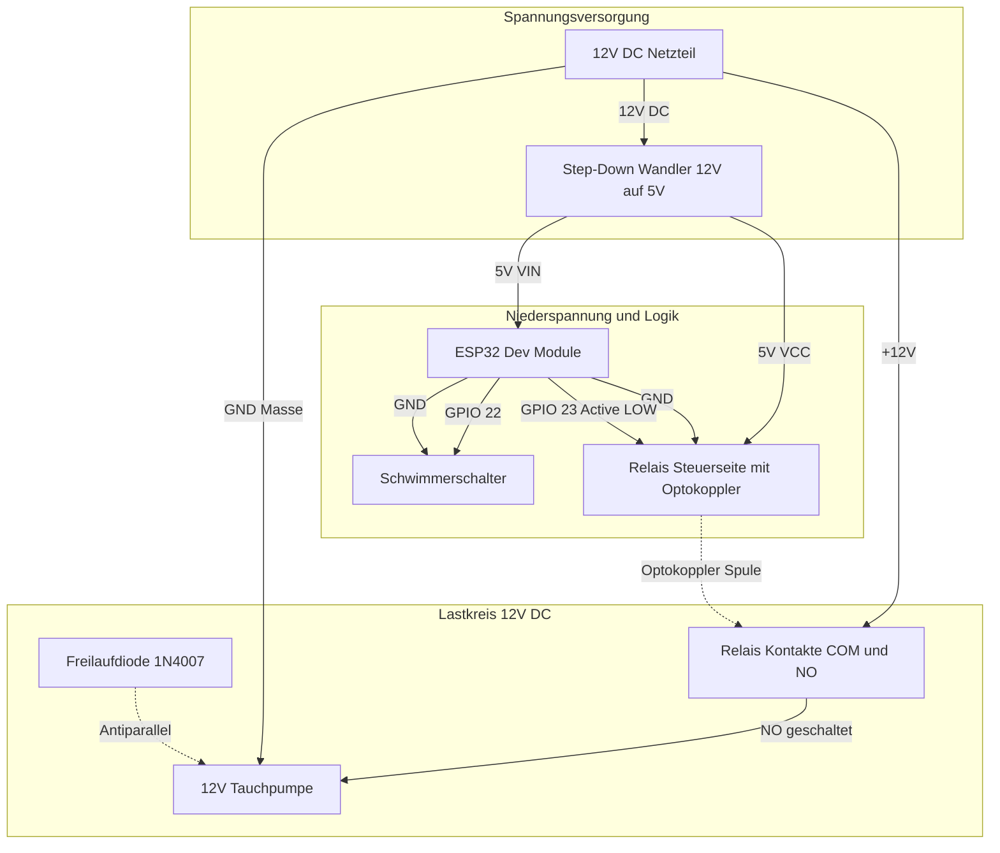

# 🔌 Hardware-Schaltplan & Verdrahtung: ESP32 Gartenbewässerung

Dieses Dokument enthält den vollständigen Schaltplan, die Verdrahtungslogik und Sicherheitshinweise für die elektronischen Komponenten und die Ansteuerung einer Wasserpumpe mit dem **ESP32**.

---

## 📑 Inhaltsverzeichnis

- [1. Übersicht & Blockschaltbild](#1-übersicht--blockschaltbild)
- [2. Hauptvariante: 12V DC Tauchpumpe (Empfohlen)](#2-hauptvariante-12v-dc-tauchpumpe-empfohlen)
  - [2.1 ASCII-Schaltplan (12V DC System)](#21-ascii-schaltplan-12v-dc-system)
  - [2.2 Schutzbeschaltung (Freilaufdiode)](#22-schutzbeschaltung-freilaufdiode)
- [3. Alternative Variante: 230V AC Gartenpumpe](#3-alternative-variante-230v-ac-gartenpumpe)
- [4. Detaillierte Verdrahtungstabelle](#4-detaillierte-verdrahtungstabelle)
- [5. Stromversorgungskonzepte](#5-stromversorgungskonzepte)
- [6. Schwimmerschalter (Trockenlaufschutz)](#6-schwimmerschalter-trockenlaufschutz)
- [7. Wichtige Praxistipps & Schutzmaßnahmen](#7-wichtige-praxistipps--schutzmaßnahmen)

---

## 1. Übersicht & Blockschaltbild



---

## 2. Hauptvariante: 12V DC Tauchpumpe (Empfohlen)

Für den Garten- und Balkonbereich werden typischerweise **12V Gleichstrom-Tauchpumpen** (oder 24V Magnetventile) empfohlen, da Kleinspannung im Nassbereich absolut berührungssicher ist.

### 2.1 ASCII-Schaltplan (12V DC System)

```text
========================================================================================
                                 GESAMTSCHALTPLAN (12V DC)
========================================================================================

   +-------------------------------------------------------------------------+
   |                            12V DC NETZTEIL                              |
   |   [ +12V ]                                                    [ GND ]   |
   +------+-----------------------------------------------------------+------+
          |                                                           |
          +-----------------------+                                   |
          |                       |                                   |
          |             +---------v---------+                         |
          |             | STEP-DOWN WANDLER |                         |
          |             | (LM2596 / Buck)   |                         |
          |             | IN+           IN- |<------------------------+
          |             | OUT+         OUT- |                         |
          |             +---+-----------+---+                         |
          |                 | 5V        |                             |
          |                 |           +-----------------+           |
          |                 |                             |           |
          |     +-----------+-------------+               |           |
          |     |                         |               |           |
          |  +--v---+                  +--v--+            |           |
          |  | VIN  |                  | VCC |            |           |
          |  |      |                  |     |            |           |
          |  | ESP32|                  | 1-KANAL          |           |
          |  | DEV  | GPIO 23 (Active  | RELAIS           |           |
          |  | BOARD| LOW Steuerung)   | MODUL            |           |
          |  |      +----------------->| IN  |            |           |
          |  |      |                  |     |            |           |
          |  |  GND +----------------->| GND |            |           |
          |  +---+--+                  +-----+            |           |
          |      |                                        |           |
          |      | GPIO 22                                |           |
          |      | (INPUT_PULLUP)                         |           |
          |      |                                        |           |
          |   +--v-----------------------+                |           |
          |   |    SCHWIMMERSCHALTER     |                |           |
          |   | (Reed-Kontakt im Tank)   |                |           |
          |   +--+-----------------------+                |           |
          |      |                                        |           |
          |      +------> GND (ESP32)                     |           |
          |                                               |           |
          |         RELAIS-LASTSEITE                      |           |
          |         +-------------+                       |           |
          +-------->| COM         |                       |           |
                    |             |                       |           |
                    |    NO       |                       |           |
                    +----+--------+                       |           |
                         |                                |           |
                         | Geschaltetes +12V              |           |
                         v                                v           |
                   +-----+--------------------------------+-----+     |
                   |  (+)                                (-)    |     |
                   |             12V TAUCHPUMPE                 |     |
                   |                                            |     |
                   |             FREILAUFDIODE                  |     |
                   |               (1N4007)                     |     |
                   |        Kathode [-|<-] Anode                |     |
                   +-----+--------------------------------+-----+     |
                         |                                |           |
                         +--------------------------------+-----------+
```

---

### 2.2 Schutzbeschaltung (Freilaufdiode)

> [!IMPORTANT]
> **Freilaufdiode (Flyback Diode) nicht vergessen!**
> Ein Pumpenmotor ist eine **induktive Last**. Beim Abschalten des Relais bricht das Magnetfeld der Motorspule schlagartig zusammen und induziert eine umgekehrte Hochspannungsspitze (oft mehrere hundert Volt).
>
> **Lösung**:
> Schließe eine Standard-Gleichrichterdiode (z. B. **1N4007** oder Schottky **1N5819**) **antiparallel** direkt an die Anschlüsse der Pumpe an:
> - **Kathode (weißer/silberner Ring):** an **(+)** der Pumpe
> - **Anode:** an **(-)** der Pumpe / GND

Ohne diese Diode kann es zu Lichtbögen an den Relaiskontakten, Systemabstürzen des ESP32 (Brownout / Reset durch elektromagnetische Störimpulse) oder Beschädigung des Relais kommen.

---

## 3. Alternative Variante: 230V AC Gartenpumpe

Falls eine reguläre 230V Schuko-Gartenpumpe geschaltet werden soll:

> [!CAUTION]
> **Lebensgefahr durch 230V Netzspannung!**
> Arbeiten an 230V dürfen nur von qualifiziertem Fachpersonal durchgeführt werden. Alle Komponenten müssen berührungssicher in einem geschlossenen, isolierten IP65-Verteilergehäuse untergebracht sein. Unbedingt über einen Fehlerstrom-Schutzschalter (FI / RCD 30mA) betreiben!

```text
230V AC Netzleitung:
  Phase (L, braun/schwarz)  ------> Relais [ COM ]
  Geschaltete Phase (L')    <------ Relais [ NO ]   ------> Pumpe (L)
  Neutralleiter (N, blau)   ------------------------------> Pumpe (N)
  Schutzleiter (PE, grün/gelb) ---------------------------> Pumpe (PE / Gehäuse)
```

**Tipp:** Verwende bei 230V induktiven Lasten (Pumpenmotoren) ein **RC-Snubber-Glied** (z. B. 100 nF X2-Kondensator in Reihe mit 100 Ω Widerstand) parallel zu den Relaiskontakten `COM` und `NO`, um Kontaktabbrand zu verhindern.

---

## 4. Detaillierte Verdrahtungstabelle

### Steuerseite (ESP32 $\leftrightarrow$ Relaismodul)

| ESP32 Pin | Relais Pin | Leitung / Farbe | Funktion |
| :--- | :--- | :--- | :--- |
| **5V / VIN** | **VCC** | Rot | Versorgungsspannung Relaisspule (5V) |
| **GND** | **GND** | Schwarz | Gemeinsames Massepotenzial |
| **GPIO 23** | **IN** | Gelb / Blau | Steuersignal (`LOW` = Relais AN, `HIGH` = Relais AUS) |

*(Hinweis: Bei Modulen mit separatem Jumper `JD-VCC / VCC` kann der Jumper gesteckt bleiben, wenn 5V vom gemeinsamen Netzteil kommt).*

### Trockenlaufschutz (ESP32 $\leftrightarrow$ Schwimmerschalter)

| ESP32 Pin | Schwimmerschalter | Modus | Signalzustand |
| :--- | :--- | :--- | :--- |
| **GPIO 22** | Kontakt 1 | `INPUT_PULLUP` | Intern auf 3.3V gezogen |
| **GND** | Kontakt 2 | Masse | Schließt Kontakt gegen GND |

- **Wasser vorhanden (Schwimmer oben):** Schalter geschlossen $\rightarrow$ GPIO 22 misst `LOW` $\rightarrow$ Pumpe darf laufen.
- **Wassertank leer (Schwimmer unten):** Schalter offen $\rightarrow$ GPIO 22 misst `HIGH` $\rightarrow$ NOT-AUS / Pumpe gesperrt.

### Lastseite (Relais $\leftrightarrow$ 12V DC Pumpe)

| Relaiskontakt | Anschlussziel | Funktion |
| :--- | :--- | :--- |
| **COM** (Common) | +12V Netzteil (+) | Wurzelkontakt / Stromeingang |
| **NO** (Normally Open) | Pumpe (+) & Kathode Diode | Schließerkontakt (führt nur Strom bei aktivem Relais) |
| **NC** (Normally Closed) | *Unbeschaltet* | Bleibt frei |
| *GND Netzteil (-)* | Pumpe (-) & Anode Diode | Masseverbindung der Pumpe |

---

## 5. Stromversorgungskonzepte

### Empfohlenes Setup: Einzelnetzteil (Single Power Supply)
Ein einziges **12V DC Netzteil** (mind. 2A bis 3A, je nach Pumpenleistung) versorgt das Gesamtsystem:
1. **12V Schiene**: Geht direkt an die Relais-Schaltseite (`COM`) zur Speisung der Pumpe.
2. **5V Schiene**: Ein kompakter Step-Down-Schaltregler (z. B. **LM2596** oder **MP1584EN**) wandelt 12V hocheffizient in stabile **5,0V** um.
3. Die 5V speisen den **VIN-Pin des ESP32** und den **VCC-Pin des Relaismoduls**.

### Alternatives Setup: Getrennte Netzteile (Dual Power Supply)
- **Netzteil 1:** 5V USB-Netzteil für den ESP32 (über Micro-USB / USB-C Buchse).
- **Netzteil 2:** Separates 12V Netzteil für die Pumpe.
- **Vorteil:** Komplette galvanische Trennung zwischen Mikrocontroller und Pumpe über den Optokoppler des Relaismoduls.
- **Hinweis:** Die GND-Verbindung der 12V Pumpe muss in diesem Fall **nicht** mit dem ESP32 GND verbunden werden.

---

## 6. Schwimmerschalter (Trockenlaufschutz)

### Mechanische Montage
- Befestige den Schwimmerschalter ca. 5–10 cm über dem Ansaugstutzen der Pumpe im Regenfass.
- **Prüfung der Kontaktlogik mit dem Multimeter vor Einbau:**
  - Standardmäßig sind Schwimmer so konstruiert, dass der interne Magnetkontakt bei aufschwimmendem Ring **schließt**.
  - Sollte der Schalter umgekehrt arbeiten, lässt sich bei den meisten Modellen der Sicherungsring an der Unterseite abziehen und der Schwimmerkörper um 180° gedreht wieder aufstecken.

---

## 7. Wichtige Praxistipps & Schutzmaßnahmen

1. **Active-LOW Relaislogik beachten:**
   Beim Einschalten des ESP32 sind GPIOs für Bruchteile einer Sekunde potenzialfrei. Im Sketch ([`sketch/sketch.ino:L80`](file:///Users/martinkade/Projekte/SmartHome/Watering/sketch/sketch.ino#L80)) wird `digitalWrite(RELAY_PIN, HIGH)` vor dem Aktivieren ausgeführt, damit die Pumpe beim Booten garantiert aus bleibt.
2. **Kondensator zur Glättung (Optional, aber empfohlen):**
   Ein **100 µF bis 470 µF Elektrolytkondensator** zwischen 5V und GND am ESP32 fängt Stromspitzen beim Einschalten des WLAN/Matter-Senders und des Relais ab.
3. **Wasserdichtes Gehäuse:**
   Platziere Elektronik, ESP32 und Relais in einem wetterfesten Gehäuse (**IP65** oder höher) mit Kabelverschraubungen (PG-Verschraubungen).
4. **Schlauch-Rückheberschutz:**
   Achte darauf, dass das Schlauchende im Beet höher liegt als der maximale Wasserstand im Fass, oder baue ein Anti-Siphon-Ventil / Belüftungsventil ein, damit Wasser nach dem Abschalten nicht durch Kapillarwirkung von alleine weiterläuft.
